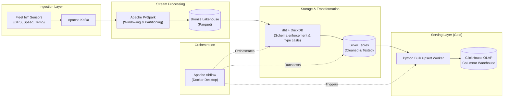

# FleetPulse

An end-to-end streaming and analytical data platform that transforms real-time fleet vehicle telemetry into actionable metrics, anomaly alerts, and fast OLAP queries.

## What and why

Vehicle telematics streams—containing GPS coordinates, instantaneous speeds, and engine temperatures—generate massive volumes of raw, noisy data. FleetPulse ingests continuous sensor feeds, stores an immutable raw event history, and moves data through a medallion lakehouse architecture. Along the way, it applies automated schema validation, custom anomaly detection tests, and aggregates metrics into an ultra-fast analytical warehouse ready for real-time fleet monitoring and spatial analytics.

| Telemetry Metric / Anomaly | Rule / Threshold | Target Layer |
|---|---|---|
| `ENGINE_OVERHEAT` | Engine coolant temperature $> 105^\circ\text{C}$ | Gold / Alerts |
| `SPEED_VIOLATION` | Vehicle speed $> 110\text{ km/h}$ | Gold / Metrics |
| `SENSOR_RANGE_CHECK` | Values outside physically valid bounds (e.g., negative speed, temp $< -40^\circ\text{C}$) | dbt Test (Silver) |
| `TELEMETRY_NULL_CHECK` | Missing `vehicle_id`, timestamp, or lat/lon coordinates | dbt Test (Silver) |
| `RAPID_DECELERATION` | Extreme speed drops within consecutive window partitions | PySpark (Bronze/Silver) |

## Architecture



- **Bronze:** Raw immutable Parquet lakehouse flushed by PySpark windowed micro-batches.
- **Silver:** dbt with DuckDB models schemas, enforces constraints via `dbt test`, and catches multi-point sensor outliers.
- **Gold:** ClickHouse columnar OLAP storage optimized for real-time sub-second aggregation and geospatial dashboards.

## Tech stack

Apache Kafka, Apache PySpark, dbt, DuckDB, ClickHouse, Apache Airflow, Python 3, Docker & Docker Compose.

## Getting started

1. Clone the repository and create an environment file (`.env`):

   ```bash
   AIRFLOW_UID=50000
   KAFKA_BROKER=localhost:9092
   CLICKHOUSE_USER=default
   CLICKHOUSE_PASSWORD=clickhouse_secret
   CLICKHOUSE_DB=fleet_analytics
   DUCKDB_PATH=/opt/lakehouse/silver.duckdb
   ```

2. Start the infrastructure stack:

   ```bash
   docker compose up -d --build
   ```

3. Initialize ClickHouse schemas:

   ```bash
   docker exec -i clickhouse-server clickhouse-client < sql/init_clickhouse.sql
   ```

4. Launch the telemetry streaming producer:

   ```bash
   python producers/telemetry_streamer.py --rate 100
   ```

5. Access the Airflow UI at <http://localhost:8080> (default credentials in `.env`), then trigger the `fleet_telemetry_pipeline` DAG.

## Data quality & testing

Data quality gates are natively enforced via `dbt test`:
- **Generic tests:** `not_null`, `unique`, and `accepted_values` across critical identifiers (`vehicle_id`, `event_timestamp`).
- **Custom anomaly tests:** SQL assertions checking for invalid GPS drift, erratic engine temperature spikes, and missing telemetry heartbeats.
- Upstream loads fail fast if test thresholds exceed the configured tolerance before writing to ClickHouse.

## Limitations

- PySpark stream writes run with micro-batch intervals; latency to Bronze is near-real-time ($\approx 5\text{--}15$ seconds) rather than true sub-second event streaming.
- DuckDB transformations execute locally inside the worker container, which is optimized for single-node scaling; distributed execution requires replacing DuckDB with a multi-node cluster engine.
- Historical replay currently requires resetting Kafka consumer group offsets manually.
